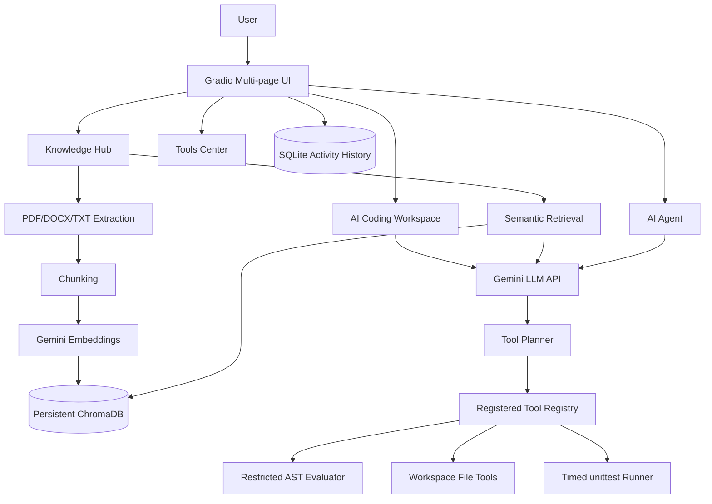

# CodePilot AI Architecture

## Main flows

- Coding: user prompt/file → prompt builder → Gemini → conversation and proposed code → explicit approval → new output file.
- RAG: upload → extract → chunk → embed → ChromaDB → query embedding → top-k retrieval → Gemini grounded answer with source labels.
- Agent: user goal → Gemini JSON plan → allowlisted tool invocation → captured results → Gemini final synthesis.
